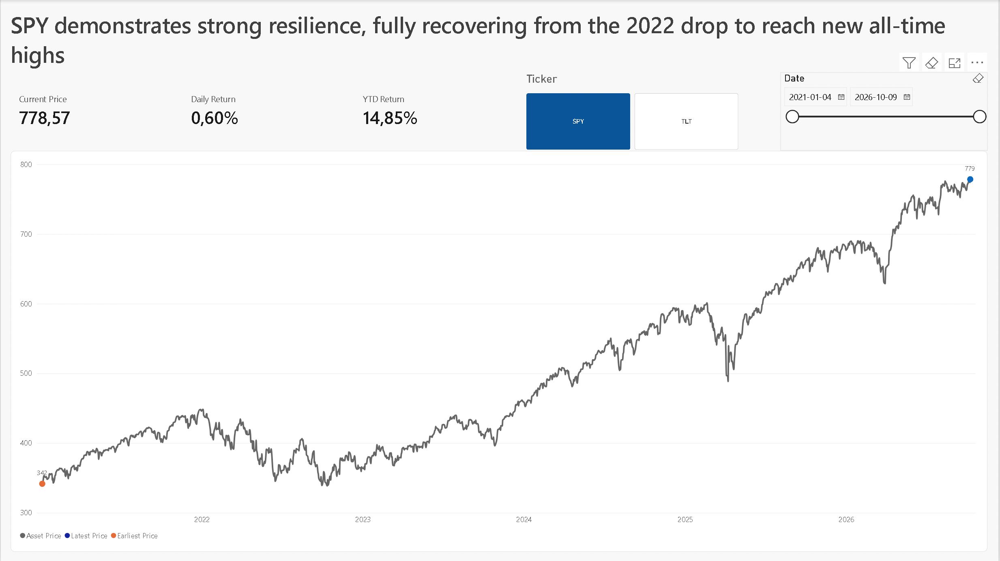
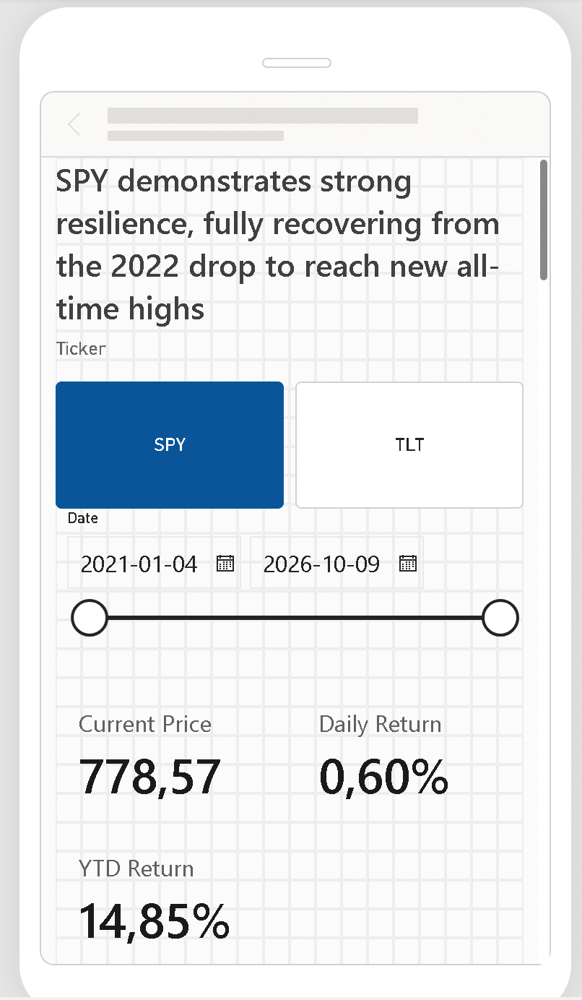
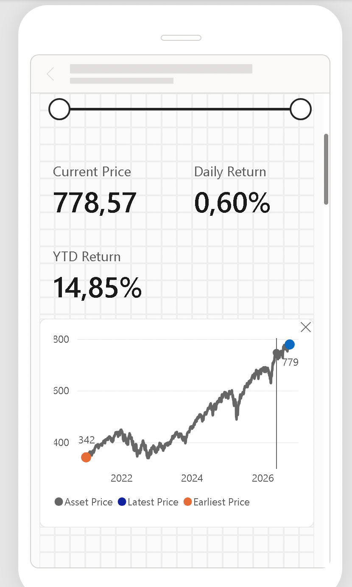

# Market Resilience Analysis: SPY vs TLT 📈

## Executive Summary
This project is an end-to-end data analytics solution designed to evaluate the long-term performance and market resilience of key ETFs (SPY and TLT). The final deliverable is an executive-level Power BI dashboard that applies strict data storytelling principles to provide clear, actionable insights into asset recovery and growth trends, particularly following the 2022 market drop.

**Key Insight:** *SPY demonstrates strong resilience, fully recovering from the 2022 drop to reach new all-time highs.*

## 🛠️ Tech Stack & Architecture
This project demonstrates a full data pipeline, from extraction to executive visualization:
* **Python (pandas, yfinance):** Data extraction and transformation (ETL). The script dynamically calculates the start date as January 1st of the year 5 years prior to the current date to ensure a complete year-to-date (YTD) context.
* **Microsoft SQL Server (Docker):** Relational database management. The script automatically connects, creates the `MarketResilience` database if missing, and loads the data into a Star Schema.
* **Power BI:** Data modeling, complex DAX measure creation, and UI/UX design.

## 🗄️ Data Model
The project utilizes a strict Star Schema architecture for optimal performance:
* **Fact Table:** `fact_prices` (contains daily historical closing prices).
* **Dimension Tables:** `dim_assets` (ticker details) and a calendar table.
* **Measures Table:** A dedicated `_measures` table utilizing a consistent `lower_snake_case` naming convention for maintaining clean DAX code.

## 🧠 Advanced DAX & Business Logic
Standard time-intelligence functions often fail in financial contexts due to market holidays and weekends. To ensure accurate percentage changes (Daily Return, YTD Return), custom DAX logic was developed. 

Instead of relying on standard `PREVIOUSDAY()`, the measures dynamically locate the *last actual trading day* using context transition and filter modification:

    VAR _last_trade_date = MAX(fact_prices[Date])
    VAR _current_closing_price = CALCULATE([closing_price], dim_date[Date] = _last_trade_date)

This ensures that KPIs remain robust and accurate, completely eliminating "blank" value errors over weekends.

## 🎨 Data Storytelling & Dashboard Design
The dashboard UI was strictly designed following the principles outlined in Cole Nussbaumer Knaflic’s *Storytelling with Data*:
* **Decluttering:** Absolute elimination of visual noise (gridlines removed, axis titles hidden where context is obvious, borders and backgrounds disabled on KPI cards).
* **Strategic Use of Color:** The dashboard operates primarily on a grayscale palette. A strong, singular brand color (blue) is used exclusively to draw the viewer's eye to the most recent data point (current price) on the trend line.
* **Visual Hierarchy:** Left-aligned typography and a carefully constructed top-to-bottom reading flow prioritize the "Big Idea" (Executive Title) down to the specific KPIs and the supporting trend chart.
* **Mobile-Optimized:** A dedicated vertical mobile layout was designed to provide executives with immediate, responsive insights on smartphone screens.

## 📸 Previews

### Desktop Executive View


### Mobile Responsive View
 

## 🚀 How to Run
1. Clone the repository and navigate to the root directory.
2. Create a `.env` file based on `.env.example` and add your MS SQL Server password: `DB_PASSWORD=your_password`.
3. Ensure your MS SQL Server Docker container is running and accessible on localhost:1433.
4. Execute the Python ETL script to fetch dynamic data and load it into the database:
   ```bash
   python scripts/etl_pipeline.py
